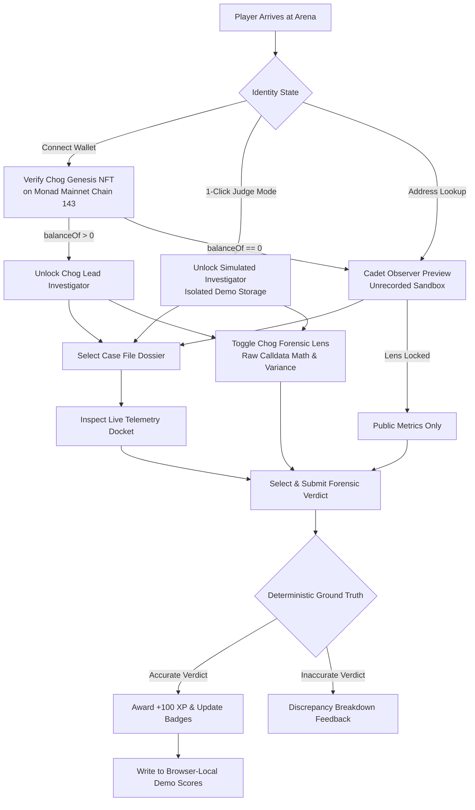
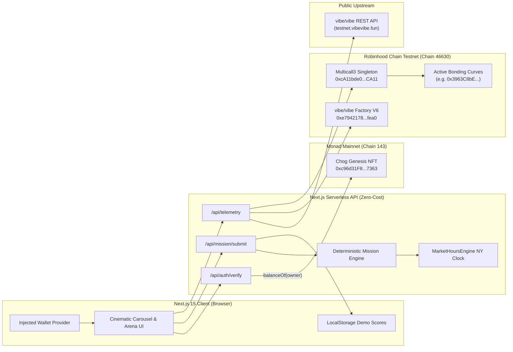

# ChogSignal Arena 🕵️

> **The On-Chain Forensic Investigation Game Powered by Verified vibe/vibe Curves & Monad Chog Genesis NFT Verification**  
> *Built for Chogathon 2026 (Chogtober 2026)*

[](https://nextjs.org/)
[](https://www.typescriptlang.org/)
[](https://viem.sh/)
[](https://tailwindcss.com/)
[](./test/run-all-tests.ts)
[-brightgreen)](#security-and-cost-model)

---

## 1. Overview & Problem Statement

In the fast-moving world of crypto launchpads (and particularly within the novel **vibe/vibe** ecosystem on **Robinhood Chain Testnet**), token launches are often fraught with hidden risks:
1. **Upstream Indexing Lags**: Third-party APIs and explorer dashboards cache data, reporting outdated graduation percentages while on-chain curves continue accumulating reserve capital.
2. **Ghost Market Oracle Disconnects**: 24/7 continuous bonding curves allow trading around the clock, while underlying Real-World Asset (RWA) and equity reference feeds (e.g., US equities) halt outside Wall Street trading sessions.
3. **Predatory Creator Taxes**: Developers can configure variable transaction surcharges (`baseTaxBps`), extracting disproportionate trading fees into creator treasuries rather than community reflections.

**ChogSignal Arena** transforms raw on-chain market monitoring into an engaging, forensic detective game. Verified **Chog Genesis NFT** holders on Monad are deputized as **Chog Forensic Auditors**. Players inspect live bonding-curve telemetry, cross-examine deterministic market clocks, unlock the **Chog Forensic Lens**, and submit mathematically verifiable forensic verdicts to earn Verified Investigator XP and badges.

---

## 2. How the Game Works



### The Distinctive Experience
- **Cinematic 4-Position Spatial Carousel**: Inspired by high-end collectible showcases, featuring an oversized ghost-typography backdrop, smooth 650ms `cubic-bezier(0.4, 0, 0.2, 1)` easing transitions, and dynamic ambient color-shifting (Cyan, Amber, Crimson, Lime).
- **Anti-Spoil Design**: Telemetry dockets show raw market parameters without pre-spoiling the answer, requiring genuine observation and analytical deduction.
- **Deterministic Evaluation**: Every mission is graded with 100% mathematical certainty against live RPC parameters. Zero AI hallucinations, zero paid API dependencies, and zero fake mock substitutions.

---

## 3. Chog Genesis NFT Utility & Essentiality

Under Chogathon rules, **NFT Essentiality** is a mandatory qualification gate: removing the NFT must materially change user capability.

| Capability | Cadet Observer (`balanceOf === 0`) | Verified Chog Holder (`balanceOf >= 1`) | Simulated Judge (`isSimulatedJudge`) |
| :--- | :---: | :---: | :---: |
| **Public Evidence Docket** | Full View (Formatted ETH) | Full View (Formatted ETH) | Full View (Formatted ETH) |
| **Chog Forensic Lens** | 🔒 **Locked** | 🔓 **Unlocked** (Raw Calldata Math) | 🔓 **Unlocked** (Isolated Demo) |
| **Exact Formula Proofs** | 🔒 **Locked** | 🔓 **Unlocked** | 🔓 **Unlocked** |
| **Score Recording** | Unrecorded (+0 XP) | Authoritative (+100 XP) | Isolated Judge Demo Key |
| **Forensic Badges** | Sandbox Practice Only | Progressive Unlock | Progressive Unlock (Demo) |

- **Contract Address**: `0xc96d31F8626c6D03Fae5dCD3d61e3FB9F4a73763` on **Monad Mainnet (`Chain 143`)**.
- **Interface**: ERC-721 (`supportsInterface(0x80ac58cd) === true`), Total Supply `1,969`.
- **Wallet Connection**: Must be authenticated via injected provider (`window.ethereum`). Manual address entry is strictly segregated into read-only Cadet Preview to prevent impersonation (DEF-01 protection).

---

## 4. The Multi-Case Investigation Docket

ChogSignal Arena features three live, evidence-backed investigation cases:

### Case File #01: Curve Graduation & Reserve Proof (`CASE_A`)
- **Objective**: Detect indexing lag between upstream launchpad APIs and on-chain bonding curves.
- **Evidence Source**: Robinhood Testnet Multicall3 reading `pairPrincipal()` and `targetPairUnits()`, compared with upstream REST board cache.
- **Validation Logic**:
  - `complete === true` ➔ `CURVE_COMPLETED`
  - `|onChainPct - apiPct| > 0.05% (5 bps)` ➔ `API_LAG_DISCREPANCY`
  - Otherwise ➔ `ACCURATE_SYNC`
- **Failure Behavior**: If curve reserve calls fail on-chain, fails closed with clear unavailable error state.

### Case File #02: Ghost Market Oracle Trap (`CASE_B`)
- **Objective**: Audit whether an equity-paired token curve is exposed to off-market oracle disconnect.
- **Evidence Source**: Deterministic `MarketHoursEngine` calculating New York Wall Street equity trading sessions ($0 cost).
- **Validation Logic**:
  - Regular Trading Hours (`09:30–16:00 ET`) ➔ `REGULAR_SESSION` (Oracles liquid & active).
  - Pre-Market, After-Hours, or Weekend Closed ➔ `OFF_MARKET_DISCONNECT` (Reference market halted while curve trades 24/7).
- **Truthful Rule**: Does *not* claim token trading halts when Wall Street closes; tests exposure to off-market oracle divergence.

### Case File #03: Creator Tax Extraction Audit (`CASE_C`)
- **Objective**: Expose predatory developer transaction surcharges.
- **Evidence Source**: On-chain Multicall3 query to curve `baseTaxBps() view returns (uint16)`.
- **Validation Logic**:
  - `baseTaxBps === 0` ➔ `ZERO_TAX` (0% Fair Launch).
  - `1 <= baseTaxBps <= 150` ➔ `STANDARD_TAX` (<= 1.5% Baseline).
  - `baseTaxBps > 150` ➔ `ELEVATED_TAX` (> 1.5% Elevated Surcharge).
- **Honest Fail-Closed Handling**: If a curve contract does not support or return `baseTaxBps`, Case C automatically renders an unavailable warning banner and disables submissions rather than fabricating data.

---

## 5. The Chog Forensic Lens

When unlocked by a verified Chog NFT holder or simulated judge, the **Chog Forensic Lens** exposes real-time calldata parameters:
1. **Raw Reserve Math**:
   - Displays exact `pairPrincipal` in wei and `targetPairUnits` in wei.
   - **Integer Scaling Proof**:
     $$\text{Graduation \%} = \frac{\text{pairPrincipal} \times 1,000,000}{\text{targetPairUnits}} \div 10,000$$
     *(Preserves 4 decimal places of precision without floating-point inaccuracy).*
2. **Variance Basis Points**:
   - Computes $\Delta = |\text{onChainPct} - \text{apiPct}|$ in basis points ($1\% = 100\text{ bps}$).
   - Automatically cross-examines against the $\pm 5\text{ bps}$ tolerance gate.
3. **Curve Lifecycle Metadata**:
   - Queries `createdAt` timestamp directly from curve bytecode.
   - Renders UTC deployment timestamp and elapsed curve duration.
4. **Contract Provenance**:
   - Displays Multicall3 lens target (`0xcA11...CA11` on Chain 46630) and explorer audit link.

---

## 6. System Architecture & Networks



### Verified Network Parameters & Contract Addresses
| Network | Chain ID | Contract / Role | Address | Standard / Method |
| :--- | :---: | :--- | :--- | :--- |
| **Monad Mainnet** | `143` | **Chog Genesis NFT** | `0xc96d31F8626c6D03Fae5dCD3d61e3FB9F4a73763` | ERC-721 (`balanceOf`, `name`, `symbol`) |
| **Robinhood Testnet** | `46630` | **Multicall3 Singleton** | `0xcA11bde05977b3631167028862bE2a173976CA11` | Standard Multicall3 |
| **Robinhood Testnet** | `46630` | **vibe/vibe Factory V6** | `0xe794217880011f9ca6961340ed5c16ec9559fea0` | `launchCount()`, `tokenOfLaunch()`, `curveOf()` |
| **Robinhood Testnet** | `46630` | **Active Bonding Curve** | Dynamic (e.g. `0x3963C8bE8C0Bdd10aC500264db894bA6a2B2B812`) | `targetPairUnits()`, `pairPrincipal()`, `baseTaxBps()`, `complete()` |

---

## 7. Security and Cost Model

- **$0 Total Infrastructure Cost**: Operates entirely over free public RPC endpoints (`https://rpc.monad.xyz` and `https://rpc.testnet.chain.robinhood.com`). No paid API keys, oracle subscriptions, or server infrastructure.
- **100% Read-Only Safety**: The codebase contains zero transaction-signing, private key handling, token transfer, or wallet write methods (`writeContract`, `sendTransaction`, `signMessage`).
- **Simulated Judge Mode Isolation**: Activating Judge Mode sets `isSimulatedJudge: true` and fixture `0x00...dEaD`. Scores write strictly to `chogsignal_simulated_judge_demo_scores_v1` and never contaminate real user scores (`chogsignal_local_demo_scores_v1`).
- **Address-Preview Segregation (DEF-01)**: Manually entered addresses in the Cadet Preview cannot claim verified holder status or write authoritative XP.
- **Transparent Local Score Scope**: All scores and badges are explicitly labeled as **Browser-Local Demo Scores**. No global or multiplayer leaderboard is falsely claimed.

---

## 8. Installation, Testing & Local Development

### Prerequisites
- Node.js `v20+` or `v22+`
- npm `v10+`

### Setup
```bash
# Clone the repository
git clone https://github.com/JimmyOgb/ChogSignal.git
cd ChogSignal

# Install dependencies
npm install

# Configure environment variables (optional; defaults are preconfigured for public RPCs)
cp .env.example .env.local
```

### Development Server
```bash
npm run dev
```
Open [http://localhost:3000](http://localhost:3000) in your browser.

### Verification Commands
```bash
# Run the 16-test automated acceptance suite (live RPC reads)
npm test

# Run strict TypeScript compilation check
npm run typecheck

# Run production Next.js build
npm run build
```

---

## 9. Vercel Deployment Guide

ChogSignal Arena is optimized for 1-click deployment on Vercel's zero-cost tier:

1. Push your repository to GitHub (`https://github.com/JimmyOgb/ChogSignal`).
2. Log in to [Vercel](https://vercel.com) and click **"Add New Project"**.
3. Import the `ChogSignal` repository.
4. Configure Project Settings:
   - **Framework Preset**: Next.js
   - **Root Directory**: `./`
   - **Build Command**: `next build`
   - **Output Directory**: `.next`
5. Environment Variables (optional; fallbacks exist in code):
   ```env
   NEXT_PUBLIC_MONAD_RPC_URL=https://rpc.monad.xyz
   NEXT_PUBLIC_ROBINHOOD_RPC_URL=https://rpc.testnet.chain.robinhood.com
   NEXT_PUBLIC_CHOG_NFT_ADDRESS=0xc96d31F8626c6D03Fae5dCD3d61e3FB9F4a73763
   NEXT_PUBLIC_MULTICALL3_ADDRESS=0xcA11bde05977b3631167028862bE2a173976CA11
   NEXT_PUBLIC_VIBE_FACTORY_ADDRESS=0xe794217880011f9ca6961340ed5c16ec9559fea0
   VIBE_API_UPSTREAM=https://testnet.vibevibe.fun
   ```
6. Click **Deploy**.

---

## 10. Judging Criteria Alignment

| Criterion | Weight | How ChogSignal Arena Delivers |
| :--- | :---: | :--- |
| **Novelty** | **30%** | Deputizes Chog NFT holders as on-chain forensic detectives cross-examining live bonding curves across Monad and Robinhood networks. Cinematic 4-position 3D spatial carousel with synchronized atmospheric color shifts and ghost typography. |
| **Fun** | **20%** | Playful rogue detective cases (*"The Ghost Market Trap"*, *"The Creator Tax Heist"*), anti-spoil evidence evaluation, and satisfying case-closed XP milestones. |
| **Retention** | **20%** | Multi-case investigation dossiers, forensic badge progression (*Rookie Sleuth*, *Curve Auditor*), and browser-local score tracking. |
| **Clarity** | **15%** | 1-Click Judge Fast-Track banner for immediate < 10 second testing, human-formatted quantities (`0.5349 ETH`), accessible inline toasts, and transparent local score labeling. |
| **Execution** | **15%** | 16/16 automated tests passing against live RPCs, 0 TypeScript errors, clean production build, 100% read-only safety, and $0 operational cost. |

---

## 11. Known Limitations & Roadmap

### Disclosed Limitations
- **Browser-Local Scores**: Scores and unlocked badges are saved in browser `localStorage`. No centralized cloud database or shared global leaderboard is claimed.
- **Public RPC Rate-Limits**: Free public endpoints may experience transient latency. If Multicall3 times out, the app fails closed with a retry button.

### Future Roadmap
- **Phase 3**: Optional $CHOG token integration bonus unlocking Mascot Dialogue Clues without token spending.
- **Phase 4**: Zero-knowledge storage proof verification for trustless cross-chain Monad-to-Robinhood state proofs.
- **Phase 5**: Decentralized IPFS profile export for cross-device score portability.

---

## 12. License & Attribution

- **License**: MIT License.
- **Ecosystem Attribution**:
  - Mascot Lore & NFT: © Chog Community / Monad Ecosystem.
  - Launchpad Contracts: vibe/vibe protocol on Robinhood Chain Testnet.
  - Companion Project: Builds on the foundational telemetry research of *StockVibe Sentinel*.
